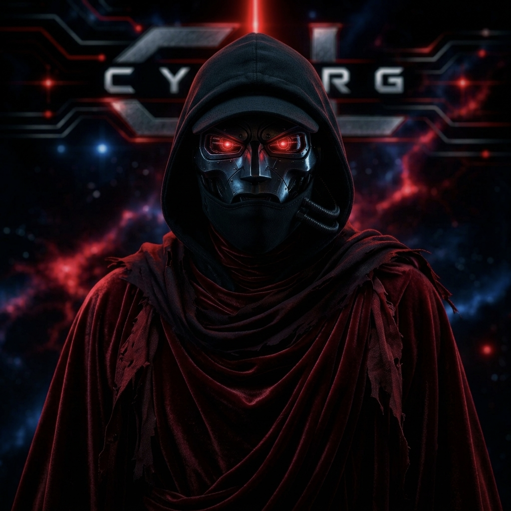
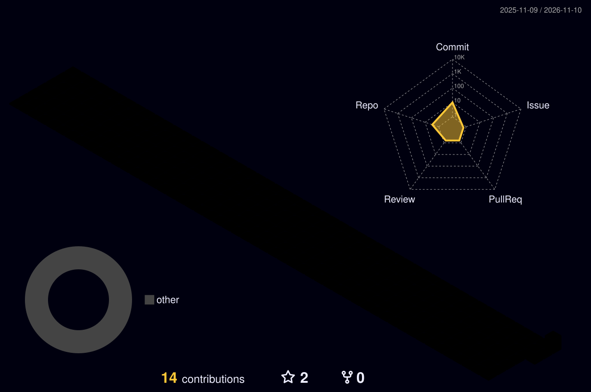

<!-- ═══════════════════════════════════════════════════════════════
     CYBORG-GL  //  GITHUB PROFILE  //  SYSTEM ONLINE
     Setup: put your image at  assets/cyborg-profile.png
     ═══════════════════════════════════════════════════════════════ -->

<div align="center">


<br/>



<br/><br/>

<a href="https://git.io/typing-svg">
  
</a>

<br/>


<br/><br/>

<a href="https://x.com/CyborgGL"></a>
<a href="mailto:cyborg.gl.in@gmail.com"></a>
<a href="https://github.com/CYBORG-GL"></a>

<br/>


</div>

---

## 🧬 `> whoami`

```ts
const cyborg = {
  handle:   "CYBORG-GL",
  role:     "Senior Full-Stack Developer",
  mission:  "Turning futuristic visions into scalable, real-world systems",
  focus:    ["AI / ML", "Cloud-native systems", "Full-stack platforms", "Game & interactive tech"],
  philosophy: "Build it bold. Ship it clean. Scale it forever.",
  status:   "Designing the next-gen evolution of futuristic TECH & more.",
} as const;
```

<div align="center">

</div>

## ⚡ Tech Arsenal

<div align="center">

### 🔤 Languages
           

### 🖥️ Frontend
    

### ⚙️ Backend & Servers
        

### 🗄️ Databases
   

### 🧠 AI / Machine Learning & Data
     

### ☁️ Cloud, DevOps & CI/CD
       

### 🧪 Testing & API
    

### 🎮 Game Tech & Hardware
    

### 🎨 Design & Creative
       

### 📋 Workflow & Productivity
 

</div>

<div align="center">

</div>

## 🛰️ Mission Control: GitHub Stats

<div align="center">


</div>

## ⏱️ WakaTime: Coding Telemetry

<div align="center">


</div>

> 🔧 *WakaTime card needs your WakaTime username to equal `CYBORG-GL` (or change the `username=` value) and **"Display code time publicly"** turned on in WakaTime settings.*

## 📈 Contribution Activity

<div align="center">


</div>

## 🌌 3D Contribution Matrix

<div align="center">



</div>

## 🐍 Snake Protocol

<div align="center">

<picture>
  <source media="(prefers-color-scheme: dark)" srcset="https://raw.githubusercontent.com/CYBORG-GL/CYBORG-GL/output/github-snake-dark.svg"/>
  <source media="(prefers-color-scheme: light)" srcset="https://raw.githubusercontent.com/CYBORG-GL/CYBORG-GL/output/github-snake.svg"/>
  
</picture>

</div>

## 🚀 Featured Repositories

<!-- Replace REPO_ONE ... REPO_SIX with your actual pinned repo names -->

<div align="center">

<a href="https://github.com/CYBORG-GL/REPO_ONE"></a>
<a href="https://github.com/CYBORG-GL/REPO_TWO"></a>
<a href="https://github.com/CYBORG-GL/REPO_THREE"></a>
<a href="https://github.com/CYBORG-GL/REPO_FOUR"></a>
<a href="https://github.com/CYBORG-GL/REPO_FIVE"></a>
<a href="https://github.com/CYBORG-GL/REPO_SIX"></a>

</div>

## 🏆 Trophies

<div align="center">


</div>

## 🔝 Top Contributed Repos

<div align="center">


</div>

## 🤖 Automation Status

<div align="center">

<a href="https://github.com/CYBORG-GL/CYBORG-GL/actions/workflows/snake.yml"></a>
<a href="https://github.com/CYBORG-GL/CYBORG-GL/actions/workflows/profile-3d.yml"></a>

</div>

## ✍️ Dev Transmission

<div align="center">


</div>

---

<div align="center">

## 💰 Fuel the Mission

<a href="https://buymeacoffee.com/YOUR_USERNAME"></a>
<a href="https://paypal.me/YOUR_USERNAME"></a>
<a href="https://patreon.com/YOUR_USERNAME"></a>
<a href="https://ko-fi.com/YOUR_USERNAME"></a>

<br/><br/>


</div>
